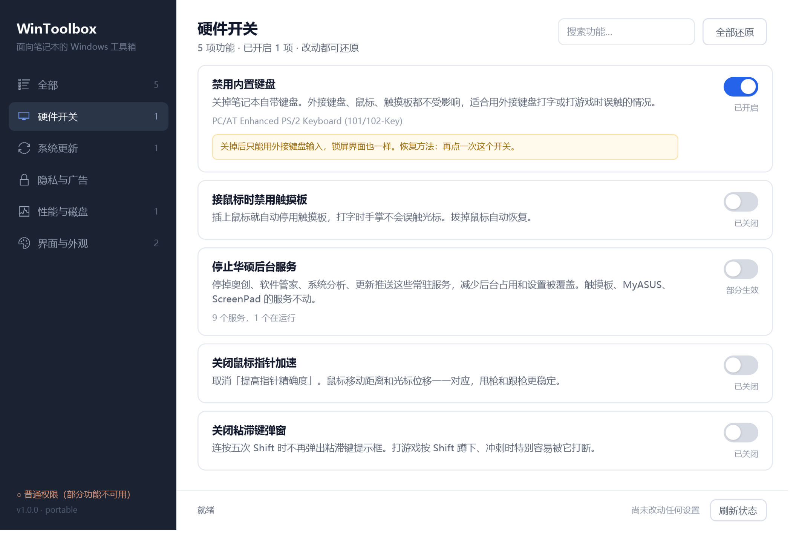

# WinToolbox

[](https://github.com/shuotian5/win-toolbox/actions/workflows/build.yml)
[](https://github.com/shuotian5/win-toolbox/releases/latest)
[](LICENSE)

A portable Windows toolbox aimed at laptops. One window, 21 switches, and **every change can
be undone** — the tool records what it overwrites before it overwrites it.

[中文说明](README.zh-CN.md)



---

## Why another one

There are already excellent tweakers — WinUtil, GTweak, Sophia Script, Optimizer. Two things
they have in common that this project deliberately does differently:

**They optimise for desktops.** Half the pain of owning a laptop is hardware: the keyboard you
keep hitting while using an external one, the touchpad your palm brushes, the vendor services
fighting over the same settings. Those are not on a desktop toolbox's radar.

**They disable Defender and activation endpoints**, which is exactly why their READMEs tell you
to add the app to your antivirus exclusions. WinToolbox does not touch Defender, SmartScreen,
UAC, activation, or your antivirus. Nothing here is a security downgrade dressed up as a tweak.

## The keyboard card

The reason this project started. Disabling a laptop's built-in keyboard while keeping every
external keyboard working is a well-known annoyance: Windows classifies the internal keyboard
as a **critical system device**, and `pnputil /disable-device`, `Disable-PnpDevice` and WMI all
refuse it with "cannot disable a critical system device".

WinToolbox tries two layers instead, verifying the real device state after each one rather than
trusting a return code:

1. **Device node** — `CM_Disable_DevNode`. Works on older builds, instant, no reboot.
2. **Driver** — set `i8042prt` to disabled and stop it. Works everywhere; usually needs a reboot.

The target is found by *"ACPI device whose driver service is `i8042prt`"*, not a hard-coded
instance ID, so it works on other machines. External keyboards (USB/Bluetooth HID), the mouse
and the precision touchpad run on completely separate stacks and are never affected.

> If the keyboard is disabled and you want it back: click the same switch again. If the machine
> has no working input at all, `WinToolbox.exe --apply internal-keyboard off` from Safe Mode, or
> just re-enable `i8042prt` in Device Manager.

## What's inside

| Category | Card | What it does |
|---|---|---|
| **Hardware** | Disable built-in keyboard | Driver-level off switch for the laptop's own keyboard |
| | Turn touchpad off with a mouse | Precision Touchpad "leave on when mouse connected" = off |
| | Stop ASUS background services | Armoury Crate / software manager / analysis / update agents |
| | Turn off mouse acceleration | Unchecks "Enhance pointer precision" |
| | Disable the Sticky Keys prompt | No more dialog after five Shift taps |
| **Updates** | Disable automatic updates | Policy + wuauserv / UsoSvc / WaaSMedicSvc |
| | Never auto-restart after updates | `NoAutoRebootWithLoggedOnUsers` |
| | Block driver updates from WU | Keeps vendor GPU/chipset drivers in place |
| **Privacy** | Minimise diagnostic data | `AllowTelemetry=0` + DiagTrack stopped |
| | Turn off Copilot | Button hidden, launch policy set |
| | Turn off taskbar widgets | News & interests panel and its feed process |
| | Turn off ads and suggestions | Start menu promos, lock screen overlays, advertising ID |
| | Keep search offline | No Bing results in Start menu search |
| **Performance** | Turn off hibernation | Deletes `hiberfil.sys` — usually 6–8 GB |
| | High performance power plan | Switches between balanced and high performance |
| | Clean temporary files | User temp + `Windows\Temp`, skips files in use |
| **Appearance** | Restore the Windows 10 context menu | Full right-click menu without "Show more options" |
| | Show file extensions | Real suffixes on every file |
| | Align taskbar to the left | Windows 11 only |
| | Dark mode | Shell and app surfaces |
| | Remove the menu show delay | Menus open without the 400 ms pause |

## Undo

Two levels, both always available:

- **Per card** — flip the switch back. The previous value is written back, not a guess at the
  default.
- **All at once** — the *Restore all* button at the top replays the journal in
  `%ProgramData%\WinToolbox\backup.json`, restoring registry values and service start types
  recorded since the first run.

Values that did not exist before are **deleted** on restore rather than set to some invented
default — that is the difference between "undo" and "get approximately close".

## Download

Grab `WinToolbox.exe` from the [releases page](https://github.com/shuotian5/win-toolbox/releases/latest). It is a single self-contained
file, no installer, no .NET runtime needed. Double-click it; Windows will ask for administrator
rights once, because changing services and machine-wide keys requires it.

The binary is unsigned, so SmartScreen will warn you the first time. That is the price of not
paying for a code-signing certificate; the full source is right here if you would rather build
it yourself.

## Command line

The same binary works without a UI, which makes it usable from a script or a fresh-install
batch:

```
WinToolbox.exe                                open the window
WinToolbox.exe --apply <id> on|off            flip one card, no UI
WinToolbox.exe --dump report.txt              write a diagnostic report
WinToolbox.exe --selftest check.txt           verify every card really applies
WinToolbox.exe --render shot.png              save a screenshot of the window
WinToolbox.exe --help                         list options

Exit codes: 0 ok / 1 failed / 2 unknown id
```

Card ids are listed by `--dump`; they are also the left-hand column of the table above, e.g.
`internal-keyboard`, `wu-disable`, `privacy-ads`.

```
WinToolbox.exe --apply wu-disable on
WinToolbox.exe --apply internal-keyboard off
```

### Check-up (`--selftest`)

The **Check-up** button in the header runs the same thing: for every registry-backed card it
does *on → read back → off → read back → restore the original values*, and only passes when
the value Windows actually stores changed.

```text
[appearance] appearance-dark  —  Dark mode
      pass：2 values written and read back, original restored
[privacy] privacy-copilot  —  Turn off Copilot
      失败 FAIL：on refused: Access to the registry key ... is denied.
```

It skips, with a reason, three groups: cards that touch hardware or services (built-in
keyboard, ASUS services, Windows Update, hibernation, power plan), action cards (temp
cleanup), and HKLM items when the process is not elevated. The header records whether the
run had administrator rights, so "skipped" is never confused with "broken".

That is deliberate: a switch that did not write anything has to fail loudly at once, instead
of being discovered a week later as "I turned it on and nothing happened".

## Build

```
dotnet publish src/WinToolbox/WinToolbox.csproj -c Release -r win-x64 ^
  --self-contained true -p:PublishSingleFile=true ^
  -p:IncludeNativeLibrariesForSelfExtract=true -p:EnableCompressionInSingleFile=true ^
  -p:DebugType=none -o dist
```

Requires the .NET 8 SDK on Windows. No NuGet packages — every system call is a
`DllImport` over `cfgmgr32`, `advapi32` and `kernel32`.

To run from source without the UAC prompt on every build:

```
dotnet build src/WinToolbox/WinToolbox.csproj -c Release -p:ApplicationManifest=app.test.manifest
```

## Notes and limits

- **Windows 10 1903+ and Windows 11.** Windows-only by construction.
- **Not every card fits every machine.** Cards that make no sense (no ASUS services, Windows 10
  for the taskbar alignment) report themselves as unavailable instead of pretending.
- **Some switches take effect at the next sign-in** — the ones that live in the shell. The card
  text says so.
- **Disabling updates is a real trade-off.** The card warns you and the undo is one click; the
  intended use is "stop the machine rebooting mid-match", not "never patch again".
- **Diagnostic reports contain registry paths and your machine name**, nothing personal. They
  are what makes issue reports answerable.

## License

MIT. Do whatever you like, no warranty.
