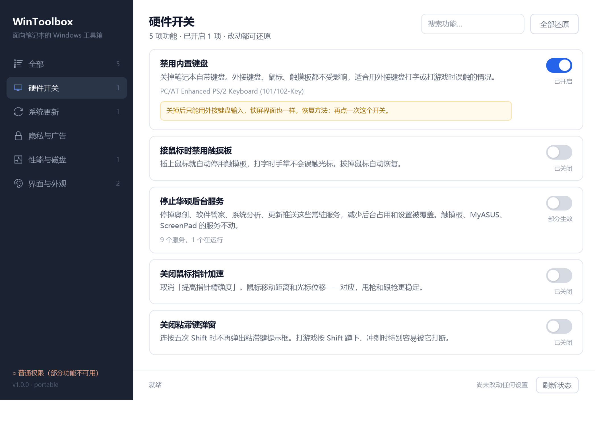

# WinToolbox

[](https://github.com/shuotian5/win-toolbox/actions/workflows/build.yml)
[](https://github.com/shuotian5/win-toolbox/releases/latest)
[](LICENSE)

面向笔记本的 Windows 工具箱。一个窗口、21 个开关，**每一次改动都能还原**——写入之前先把
原来的值记下来，还原时写回去，而不是猜一个"默认值"。

[English](README.md)



---

## 为什么还要再做一个

Windows 优化工具已经很多了：WinUtil、GTweak、Sophia Script、Optimizer。它们有两个共同的
特点，而这个项目刻意做得不一样：

**它们是为台式机设计的。** 笔记本一半的痛点来自硬件——用外接键盘时总是误触自带的键盘、
手掌蹭到触摸板、厂商的几个服务抢同一批设置。这些在台式机工具箱的视野之外。

**它们会关掉 Defender 和激活**,这正是它们的 README 要你"把软件加入杀软白名单"的原因。
WinToolbox 不碰 Defender、SmartScreen、UAC、激活，也不碰你的杀软。这里没有任何一项是把
安全降级包装成"优化"。

## 内置键盘那一项

这个项目就是从这来的。禁用笔记本自带键盘、同时保留所有外接键盘，是件很烦的事：Windows 把
内置键盘归类为**关键系统设备**，`pnputil /disable-device`、`Disable-PnpDevice` 和 WMI 全都
会以"无法禁用关键系统设备"拒绝。

WinToolbox 不再走设备层，而是两层依次尝试，**每一步都回读真实设备状态**，不信返回码：

1. **设备节点** —— `CM_Disable_DevNode`。旧版本系统上可用，立刻生效，不用重启。
2. **驱动** —— 把 `i8042prt` 设为禁用并停止。全平台可用，通常需要重启。

设备的定位方式是「**驱动服务为 `i8042prt` 的 ACPI 设备**」，不是写死的实例 ID，所以换一台
机器也能用。外接键盘（USB / 蓝牙 HID）、鼠标、精密触摸板走的是完全独立的驱动栈，不受影响。

> 禁用了想恢复：再点一次同一个开关。如果机器上已经没有任何可用输入，
> 在安全模式下执行 `WinToolbox.exe --apply internal-keyboard off`，或者在设备管理器里重新
> 启用 `i8042prt`。

## 功能一览

| 分类 | 开关 | 作用 |
|---|---|---|
| **硬件开关** | 禁用内置键盘 | 驱动层的笔记本自带键盘开关 |
| | 接鼠标时禁用触摸板 | 关闭精密触摸板的"连接鼠标时保持开启" |
| | 停止华硕后台服务 | 奥创、软件管家、系统分析、更新推送 |
| | 关闭鼠标指针加速 | 取消「提高指针精确度」 |
| | 关闭粘滞键弹窗 | 连按五次 Shift 不再弹窗 |
| **系统更新** | 彻底禁用自动更新 | 策略 + wuauserv / UsoSvc / WaaSMedicSvc |
| | 禁止更新后自动重启 | `NoAutoRebootWithLoggedOnUsers` |
| | 阻止更新推送驱动 | 保住厂商的显卡、芯片组驱动 |
| **隐私与广告** | 关闭诊断数据上传 | `AllowTelemetry=0` + 停 DiagTrack |
| | 关闭 Copilot | 隐藏按钮并禁止启动 |
| | 关闭任务栏小组件 | 天气资讯面板及其后台进程 |
| | 关闭系统广告与推荐 | 开始菜单推荐、锁屏推广、广告 ID |
| | 关闭搜索栏联网 | 开始菜单搜索不出 Bing 结果 |
| **性能与磁盘** | 关闭休眠 | 删除 `hiberfil.sys`，通常 6–8 GB |
| | 高性能电源计划 | 平衡 / 高性能之间切换 |
| | 清理临时文件 | 用户临时目录 + `Windows\Temp`，跳过占用中的文件 |
| **界面与外观** | 恢复 Win10 右键菜单 | 不用每次点「显示更多选项」 |
| | 显示文件扩展名 | 每个文件都带真实后缀 |
| | 任务栏图标左对齐 | 仅 Win11 |
| | 深色模式 | 系统与应用界面 |
| | 去掉菜单弹出延迟 | 菜单不再停顿 400 毫秒 |

## 还原

两层，随时可用：

- **单项还原** —— 把开关点回去。写回的是原来的值，不是对默认值的猜测。
- **一键全部还原** —— 顶部「全部还原」会把 `%ProgramData%\WinToolbox\backup.json` 里的记录
  逐条回放，恢复从第一次运行以来改过的注册表值和服务启动类型。

原来**不存在**的值，还原时会被删除,而不是写入某个臆想的默认值。这是"还原"和"差不多还原"
的区别。

## 下载

到 [releases 页面](https://github.com/shuotian5/win-toolbox/releases/latest) 下载 `WinToolbox.exe`。单文件、免安装、不需要装 .NET
运行时。双击即可，Windows 会要一次管理员权限——改服务和系统级注册表必须要。

程序没有代码签名，第一次运行 SmartScreen 会警告。这是没买签名证书的代价；不想信这个二进制
的话，源码就在这里，自己编译。

## 命令行

同一个 exe 也能不开界面使用，方便写进脚本或者装机批处理：

```
WinToolbox.exe                                打开窗口
WinToolbox.exe --apply <id> on|off            直接切换某一项
WinToolbox.exe --dump report.txt              生成诊断报告
WinToolbox.exe --selftest check.txt           逐项验证每个开关真的生效
WinToolbox.exe --render shot.png              保存界面截图
WinToolbox.exe --help                         查看参数

退出码：0 成功 / 1 失败 / 2 找不到该 id
```

各项的 id 可以用 `--dump` 看到，也就是上表左列的英文，例如 `internal-keyboard`、
`wu-disable`、`privacy-ads`。

```
WinToolbox.exe --apply wu-disable on
WinToolbox.exe --apply internal-keyboard off
```

### 体检（`--selftest`）

界面右上角的「体检」按钮，和 `--selftest` 是同一件事：对每一张注册表卡片做一次
**开启 → 读回 → 关闭 → 读回 → 还原原值**，只有 Windows 真存下了那个值才算通过。

```text
[appearance] appearance-dark  —  深色模式
      通过 pass：2 个值写入并读回一致，已还原
[privacy] privacy-copilot  —  关闭 Copilot
      失败 FAIL：开启被拒绝：Access to the registry key ... is denied.
```

它跳过三类卡片并说明原因：会改硬件或服务的（内置键盘、华硕服务、Windows 更新、
休眠、电源计划）、纯动作型（清理临时文件）、以及非管理员运行时的 HKLM 项目。
报告开头会写明本次是否具备管理员权限，所以「跳过」和「失败」不会混在一起。

这个自检是刻意设计成这样的：一个开关只要没有真的写进去，就必须当场报错，而不是等
用户一周后才发现「开了没用」。

## 编译

```
dotnet publish src/WinToolbox/WinToolbox.csproj -c Release -r win-x64 ^
  --self-contained true -p:PublishSingleFile=true ^
  -p:IncludeNativeLibrariesForSelfExtract=true -p:EnableCompressionInSingleFile=true ^
  -p:DebugType=none -o dist
```

需要 Windows 上的 .NET 8 SDK。没有任何 NuGet 依赖——所有系统调用都是对 `cfgmgr32`、
`advapi32`、`kernel32` 的 `DllImport`。

如果想从源码调试又不想每次弹 UAC：

```
dotnet build src/WinToolbox/WinToolbox.csproj -c Release -p:ApplicationManifest=app.test.manifest
```

## 说明与限制

- **支持 Windows 10 1903+ 与 Windows 11。** 只支持 Windows。
- **不是每台机器都有每一项。** 没有意义的卡片（没有华硕服务、Win10 上的任务栏对齐）会显示
  为不可用，而不是假装能用。
- **部分开关要重新登录才生效**——住在资源管理器里的那几项，卡片描述里会写明。
- **禁用更新是真实的取舍。** 卡片上有警告，还原一次点击；它的用途是"别在打游戏时自动重启",
  不是"从此不打补丁"。
- **诊断报告包含注册表路径和机器名**,没有隐私内容。它是 issue 能被回答的前提。

## 许可

MIT。随便用，不担保。
